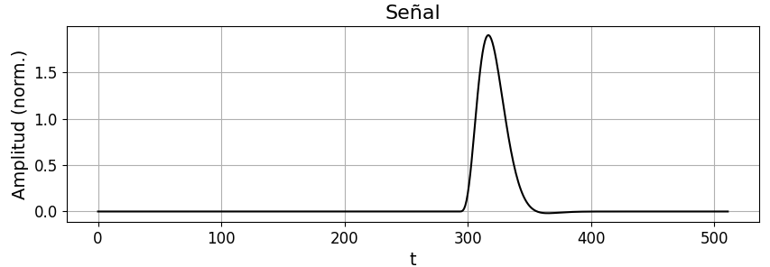
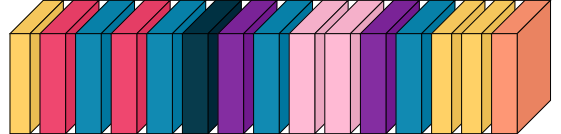
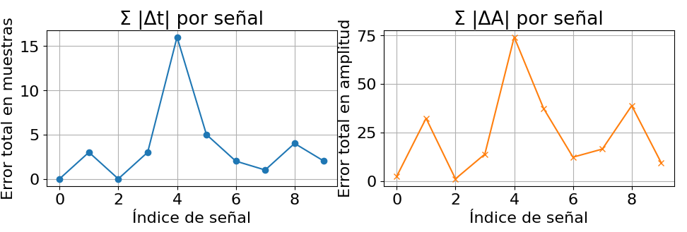
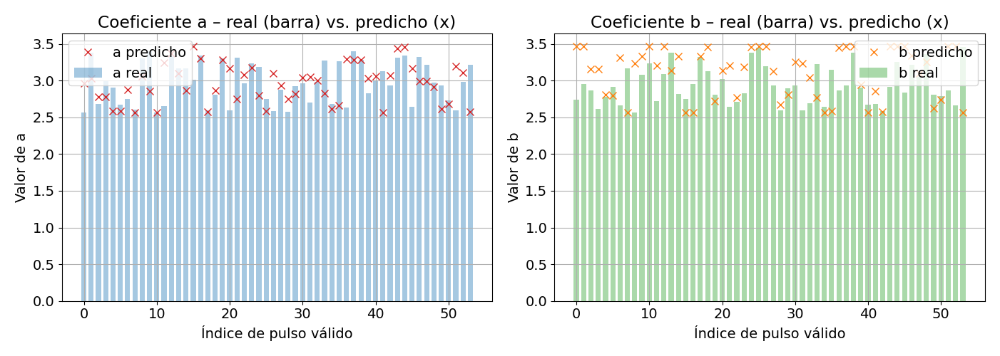

# Micromegas Pulse Reconstruction

**Deconvolution and machine learning for overlapping particle-detector signals.**

This project investigates how to recover individual events from digitized Micromegas-like waveforms. It compares a classical least-squares approach with neural-network models and numerical refinement. Most experiments use **synthetic labelled signals**; ROOT data reading is available as a separate example.



## Approach

- **Fixed detector response:** reconstruct pulse amplitudes using linear least squares.
- **Variable detector response:** explore an encoder–decoder–regressor baseline.
- **Specialist neural network:** combine convolutions, multi-head attention and recurrent layers to predict pulse times, amplitudes and response parameters.
- **Numerical refinement:** improve predicted event parameters with nonlinear optimisation.



## Results



The experiments suggest accurate timing estimates under the tested synthetic conditions; amplitude reconstruction remains more challenging. The figures are **exploratory results, not validated performance on an independent real-detector dataset**.



For the full scientific discussion, intermediate models and additional plots, see [Detailed project notes](docs/technical_notes.md).

## Getting started

Use a Python installation compatible with TensorFlow, preferably within a virtual environment. From the repository root:

```bash
python -m pip install -r requirements.txt
```

To run inference and numerical refinement using the bundled Keras checkpoint:

```bash
python src/sampler.py
```

To train a new model:

```bash
python src/transformer_model.py
```

Training generates a large synthetic dataset and can require significant memory and computation. To try resuming from `models/best_model.keras`, run:

```bash
python src/transformer_model.py --resume
```

The provided dependency list is **not a version-pinned lockfile**. Compatibility with pretrained `.keras` models can depend on your TensorFlow/Keras version.

## Main files

| Path | Description |
| --- | --- |
| [`src/deconvolution.py`](src/deconvolution.py) | Classical reconstruction routines |
| [`src/signal_generator.py`](src/signal_generator.py) | Synthetic data generation |
| [`src/transformer_model.py`](src/transformer_model.py) | Neural architecture and training |
| [`src/sampler.py`](src/sampler.py) | Inference and numerical refinement |
| [`src/result_reader.py`](src/result_reader.py) | Visualise saved reconstruction results |
| [`src/root_reader.py`](src/root_reader.py) | Example ROOT waveform reader |
| [`models/`](models/) | Pretrained Keras models |
| [`figures/`](figures/) | Model diagrams and experimental results |

The ROOT example currently uses a **hard-coded local filename and event index**. Edit these in `src/root_reader.py` before using your own data; ROOT files are not included.

## Scope

This is a research and exploration project rather than a production reconstruction system. No automated benchmark or test suite is currently included. The numerical results mainly concern synthetically generated waveforms, and model training does not yet guarantee identical results across runs.

## Further reading

[Detailed methodology, figures, experiments and future directions](docs/technical_notes.md).
